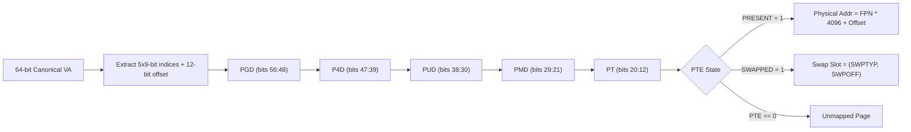

# Member 2: 64-Bit 5-Level Paging and MMU

## 1. 64-Bit 5-Level Paging Architecture

Each `struct mm_struct` owns an isolated root `pgd` table of `512` 64-bit entries (`512 * 8 = 4096` bytes). Non-leaf directory entries (`PGD`, `P4D`, `PUD`, `PMD`) store pointers to demand-allocated child tables, and leaf `PT` entries store 64-bit PTEs. The legacy flat `p4d`/`pud`/`pmd`/`pt` fields on `mm_struct` are not used as independent roots; all walks start from `mm->pgd` using all five 9-bit indices.

### Virtual Address Bit Layout (57-Bit Canonical Address Space)

| Bits | `[63:57]` | `[56:48]` | `[47:39]` | `[38:30]` | `[29:21]` | `[20:12]` | `[11:0]` |
| :---: | :---: | :---: | :---: | :---: | :---: | :---: | :---: |
| **Field** | Sign extension of bit 56 | `PGD` index | `P4D` index | `PUD` index | `PMD` index | `PT` index | Page offset |
| **Width** | 7 bits | 9 bits (512) | 9 bits (512) | 9 bits (512) | 9 bits (512) | 9 bits (512) | 12 bits (4 KiB) |

- `get_pd_from_address()` rejects non-canonical addresses (where bits `[63:57]` do not match bit `56`).
- `get_pd_from_pagenum()` shifts `pgn` left by 12 bits (`PAGING64_ADDR_PT_SHIFT`) and delegates to `get_pd_from_address()`, supporting both lower-half user addresses and upper-half kernel addresses (e.g. `0xff00000000000000` -> `PGD = 256`).
- `0x1fffff` maps to `PMD = 0, PT = 511`; `0x200000` crosses the 2 MiB boundary into `PMD = 1, PT = 0`.

### 5-Level Address Translation Diagram



### PTE State and Range Macros (`include/mm.h`, `include/mm64.h`)

- `PTE == 0` represents an unmapped page; physical frame `0` is valid because `PRESENT` (bit `31`) makes the PTE non-zero (`0x80000000`).
- **RAM-resident page:** `PRESENT = 1`, `SWAPPED = 0`, 13-bit `FPN` in bits `[12:0]` (`0..8191`).
- **Swapped-out page:** `PRESENT = 0`, `SWAPPED = 1`, `SWPTYP` in bits `[4:0]`, `SWPOFF` in bits `[25:5]`.
- Fixed the starter typo in `include/mm64.h` (`PAGING64_ADDR_OFFST` and `PAGING64_ADDR_OFFST_MASK` now use the 12-bit `PAGING64_ADDR_OFFST_*` constants instead of the 8-bit 32-bit macros).
- Implemented half-open `[start, end)` range macros in `include/mm.h`:
  - `INCLUDE(x1,x2,y1,y2)`: `((x1) <= (y1)) && ((y1) <= (y2)) && ((y2) <= (x2))`
  - `OVERLAP(x1,x2,y1,y2)`: `((x1) < (x2)) && ((y1) < (y2)) && ((x1) < (y2)) && ((y1) < (x2))`

---

## 2. Integration Interfaces and Synchronization

- **`alloc_pages_range()`:** Allocates `req_pgnum` RAM frames through `MEMPHY_get_freefp()`. Returns `0` on success, `(addr_t)-3000` when physical RAM runs out, or `(addr_t)-1` on invalid arguments / allocation failure. On failure, already-reserved frame nodes are spliced back via `MEMPHY_put_freefp_list()` under `memphy_lock` without allocating memory, and `*frm_lst` is set to `NULL`.
- **`vmap_page_range()`:** Maps a page-aligned canonical range using frames reserved by the caller and pushes mapped `pgn` entries onto `mm->fifo_pgn`. If any step fails (existing mapping, non-canonical range, or OOM allocating intermediate tables), all newly created tables are freed and rolled back with no partial PTE or FIFO commit.
- **`vm_map_ram()`:** Combines `alloc_pages_range()` and `vmap_page_range()`, returning reserved frame nodes via `MEMPHY_put_freefp_list()` (allocation-free) on mapping failure and freeing temporary frame list nodes on success.
- **`vmap_pgd_memset()`:** Demand-allocates zeroed PTE slots for an unmapped range (`SYSMEM_MAP_OP`) while rejecting ranges that already contain active mappings and rolling back newly allocated tables on error.
- **`__swap_cp_page()`:** Copies `4096` bytes between physical devices, checking for `NULL` devices and propagating any `MEMPHY_read()` / `MEMPHY_write()` error (`-1`).
- **`destroy_mm()`:** Frees the 5-level page table tree, VMA list, free-region nodes, FIFO list, and `kcpooltbl`, then zeroes `mm` so repeated calls are safe. Callers must reclaim physical RAM/swap frames beforehand (as in `free_pcb_memph()`).
- **`print_pgtbl()`:** Walks populated directory paths in `[start, end)` (including `end == UINT64_MAX`) and prints `PDG=... P4D=... PUD=... PMD=...PT=...`. Printing the `MMU pte_lookup_reads=... page_table_bytes=...` summary line is gated by `#ifdef MMDBG` so default simulator output matches the reference format cleanly.
- **Locking:** `page_table_lock` guards page-table walks, updates, dumps, and `destroy_mm()`, while `alloc_pages_range()` / `return_frames()` release `page_table_lock` and route all `free_fp_list` operations through `MEMPHY_get_freefp()` / `MEMPHY_put_freefp_list()` (`memphy_lock`) so frame rollback is both race-free and allocation-free.

---

## 3. Storage and Access Statistics

Two counters are maintained on `struct mm_struct`:
- `page_table_bytes`: total bytes currently allocated for live page-table nodes (`4096` bytes per table; excludes VMA/FIFO metadata).
- `pte_lookup_reads`: total page-table entries read by `pte_get_entry()` (an early miss at `PGD` adds `1`; a full 5-level walk adds `5`; `print_pgtbl()` does not increment this counter).

### Measured Unit-Test Numbers (`tests/mm64_test.c`)

| Scenario | Live Tables | `page_table_bytes` | `pte_lookup_reads` Added |
| :--- | :---: | :---: | :---: |
| Fresh `init_mm()` (empty PGD only) | 1 | `4096` B (4 KiB) | `0` |
| Unmapped lookup (`pte_get_entry` miss at PGD) | 1 | `4096` B (4 KiB) | `+1` |
| First mapped page (`pgn = 42`) | 5 | `20480` B (20 KiB) | `+5` per lookup |
| Adjacent page in same 2 MiB PT (`0x1ff000` -> `0x200000` boundary) | +1 PT (6 total) | `24576` B (24 KiB) | `+5` per lookup |
| 2-thread concurrent test (129 full lookups across 2 PTs) | 6 | `24576` B (24 KiB) | `645` (`5 * 129`) |

### Measured OS Simulation Numbers (`-DMMDBG=1`, 4-Member Integration Build)

| Workload | CPUs | RAM Size | `print_pgtbl` Dumps | Peak `page_table_bytes` / Process | Peak `pte_lookup_reads` / Process | Exit |
| :--- | :---: | :---: | :---: | :---: | :---: | :---: |
| `os_0_mlq_paging` | 2 | 256 MiB | 14 | `20480` B (5 tables) | `10` | `0` |
| `os_1_singleCPU_mlq_paging` | 1 | 1 MiB | 7 | `20480` B (5 tables) | `5` | `0` |
| `os_1_mlq_paging` | 4 | 256 MiB | 14 | `20480` B (5 tables) | `10` | `0` |
| `os_1_mlq_paging_small_4K` | 4 | 4 KiB (1 frame) | 7 | `20480` B (5 tables) | `10` | `0` |
| `os_2_singleCPU_mlq_paging` | 1 | 1 MiB | 6 | `20480` B (5 tables) | `0` | `0` |

---

## 4. Q5: Benefits of N-Level Hierarchical Paging (Page 18)

### Space Savings for Large, Sparse Address Spaces

In this simulator's 57-bit canonical address space with 4 KiB pages (`12`-bit offset), there are $2^{45}$ possible virtual pages per process. Each PTE takes 8 bytes:

| Design | Page Table Size (1 Mapped Page) | Page Table Size (512 Contiguous Pages / 2 MiB) | Worst-Case Contiguous Allocation |
| :--- | :--- | :--- | :--- |
| **1-Level Flat Table** | $2^{45} \times 8\text{ B} = 256\text{ TiB}$ per process | $256\text{ TiB}$ per process | Single huge contiguous block |
| **5-Level On-Demand Table** | $5 \times 4\text{ KiB} = 20\text{ KiB}$ | $5 \times 4\text{ KiB} = 20\text{ KiB}$ (shared PT) | Individual `4 KiB` frames |

Because processes only touch a tiny fraction of a 64-bit address space (code, heap, stack, and a few mapped regions separated by huge unmapped gaps), allocating intermediate directories only along active branches cuts page-table memory from terabytes down to tens of kilobytes. Every table node fits in exactly one 4 KiB physical page (`512 * 8` bytes), avoiding external fragmentation and removing the need for large physically contiguous kernel allocations.

### Scalability and Sharing

- Adding another level expands the addressable virtual space by $512\times$ (9 bits) without enlarging individual page-table nodes.
- Upper directory entries can be shared across processes (for example, kernel-half mappings in upper `PGD` entries) or copied lazily.

### Performance Trade-offs

- **Translation latency:** A cold lookup in an $N$-level table requires up to $N$ memory reads (`5` in this simulator) before reading the target byte, compared to `1` read in a flat table. Real CPUs hide almost all of this overhead with **TLBs** (caching `VPN -> FPN` directly) and **page-walk caches** (caching `PGD`/`P4D`/`PUD`/`PMD` intermediate pointers).
- **Management overhead:** Demand allocation requires extra kernel logic for allocating, synchronizing (`page_table_lock`), rolling back on OOM, and recursively freeing intermediate tables on process exit (`destroy_mm()`).

---

## 5. Verification

### Running Tests

On Ubuntu/Linux:

```bash
make test-mm64
make test-member3
```

On Windows (MinGW GCC):

```powershell
gcc -std=gnu11 -Wall -Wextra -O1 -g -pthread -Iinclude tests/mm64_test.c src/mm64.c "-Wl,--wrap=calloc" -o obj/mm64_test.exe
.\obj\mm64_test.exe
gcc -std=gnu11 -Wall -Wextra -O1 -g -pthread -Iinclude tests/mm64_memphy_test.c src/mm64.c src/mm-memphy.c "-Wl,--wrap=calloc" "-Wl,--wrap=malloc" -o obj/mm64_memphy_test.exe
.\obj\mm64_memphy_test.exe
```

To enable the MMU lookup/storage summary line in `print_pgtbl()`, compile with `-DMMDBG=1` (or uncomment `#define MMDBG 1` in `include/os-cfg.h`).

### Results

- `tests/mm64_test.c` passes all checks: `INCLUDE`/`OVERLAP`, 12-bit offset masks, 5-level index extraction, canonical address rejection, per-`mm` isolation, frame `0`, RAM/swap PTE transitions, `vmap_pgd_memset`, `calloc`-failure rollback, `__swap_cp_page` error handling, NULL helper guards, 2-thread concurrent access, and idempotent `destroy_mm()`.
- `tests/mm64_memphy_test.c` links real `src/mm64.c` with real `src/mm-memphy.c` under both `--wrap=calloc` and `--wrap=malloc` fault injection, verifying zero lost/duplicate frames, exact FPN-set preservation, no partial PTE/FIFO commits for `alloc_pages_range()` and `vm_map_ram()` (page-table OOM, FIFO-node OOM, and overlap-mapping failure), plus 4-thread concurrent rollback stress.
- `tests/member3_test.c` passes 4/4 suites linking `src/mm64.c` with real `src/mm-memphy.c`, `src/mm-vm.c`, and `src/sched.c`.
- All 9 OS integration workloads (`os_0_mlq_paging`, `os_1_singleCPU_mlq_paging`, `os_1_mlq_paging`, `os_1_mlq_paging_small_1K`, `os_1_mlq_paging_small_4K`, `os_syscall_list`, `os_syscall`, `os_sc`, `os_2_singleCPU_mlq_paging`) passed with exit code `0` in both default and `-DMMDBG=1` builds.
